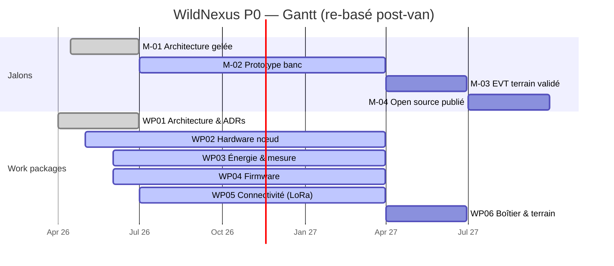

je l'ai versé à # WildNexus P0 — Gantt

**Date :** 2026-10-31 · **Statut projet :** ⚪ gelé jusqu'au 15/12 (post-van), dates re-basées.
**Rendu :** Obsidian / GitHub / Plane (via fichier `.md`). Vue détaillée : [`PLANNING_GANTT.md`](PLANNING_GANTT.md).



## Légende

- `done` (vert) — terminé : M-01, WP01.
- `active` (bleu) — en cours / partiel : M-02, WP02→WP05.
- sans tag (gris) — planifié : M-03, M-04, WP06.

> ⚠️ **Gel Q4 2026** : les barres WP02→WP05 et M-02 couvrent le gel (focus IOT/VETALYX
> jusqu'au 15/12). Le bench redémarre post-van → d'où la date de fin Q1 2027.

## Dépendances (relations Plane `blocked_by`)

```
M-01 → M-02 → M-03 → M-04          (chaîne de jalons)
WP02, WP03, WP04, WP05  →  M-01    (les WPs démarrent après M-01)
WP06  →  M-02                        (l'EVT démarre après le prototype banc)
```

## Correspondance dates / fichier source

Les dates ci-dessus proviennent de [`00_GOVERNANCE/wildnexus-plane-gantt.json`](WILDNEXUS_DEVICE/00_GOVERNANCE/wildnexus-plane-gantt.json) — source unique des dates + états + dépendances, synchronisée dans Plane (25 items).

---
*Généré le 2026-10-31 par Dobby 🦉.*
