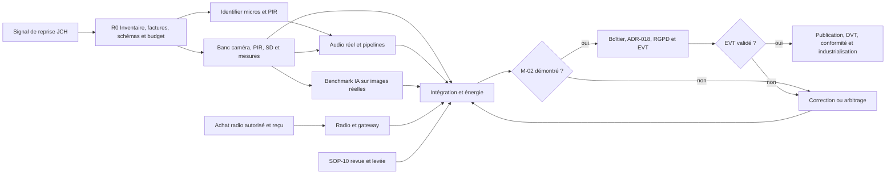

# WildNexus P0 — Vue de dépendances

Version révisée : 2026-11-05. Projet gelé ; reprise post-van non datée. La vue détaillée et les critères sont dans `PLANNING_GANTT.md`.

Les anciennes barres Q1–Q3 2027 étaient des estimations devenues obsolètes. Elles sont retirées plutôt que remplacées par de nouvelles dates sans disponibilité confirmée.

Les 37/37 tests hôte historiques restent une preuve logicielle, pas une validation de ce chemin matériel. La projection budgétaire provisoire de 904 € dépasse le seuil interne de 900 € : aucune nouvelle commande sans réconciliation et autorisation.

Plane et le fichier JSON de seed sont des instantanés à revoir à la reprise. Ne pas rejouer les anciennes dates ni lancer de remplacement externe automatique depuis ce document.
