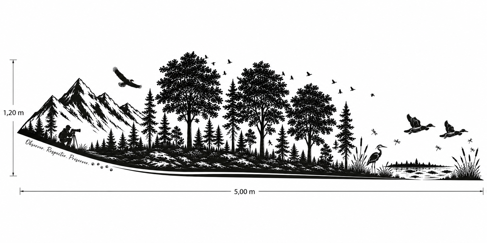
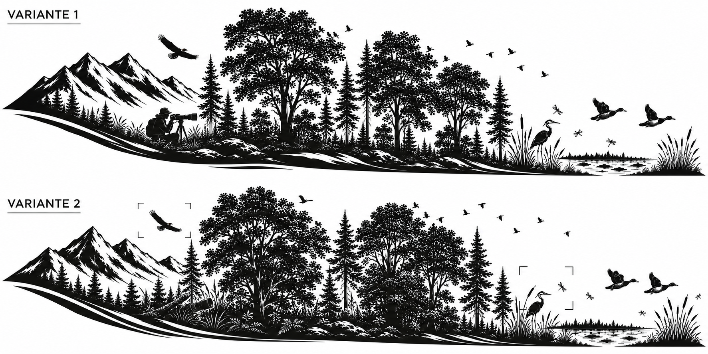

**Variante 1 — Photographe intégré discrètement dans le paysage**  
  
Créer un sticker panoramique noir monochrome, au style silhouette vectorielle élégante et légèrement stylisée, destiné au flanc droit d’un Westfalia Kelsey. Format réel : 5 mètres de long, hauteur maximale 1,20 m. La composition commence plus haute à l’arrière du véhicule puis descend progressivement vers l’avant.  
  
De gauche à droite : montagnes enneigées, forêt mixte de grands sapins et de feuillus très touffus, puis petite zone humide avec roseaux, plantes aquatiques et étang. Ajouter un aigle impérial européen en vol, entièrement noir, tête et queue noires, de taille modérée. Dans les arbres, placer de très petits oiseaux, environ 30 % plus petits que les versions précédentes, certains volant entre les branches et d’autres perchés ou visibles dans la partie haute des feuillus. Dans la zone humide, intégrer un héron, deux canards colverts en silhouette classique et quelques libellules.  
  
Pour évoquer clairement la photographie animalière, placer un photographe discret, agenouillé ou assis derrière un appareil photo équipé d’un long téléobjectif monté sur trépied. Le personnage doit être intégré à la lisière de la forêt, partiellement fondu dans la végétation, sans dominer la scène. Aucun texte. Style cohérent, découpe vinyle possible, détails simplifiés, masses noires équilibrées et espaces blancs suffisants.  
  
**Variante 2 — La photographie suggérée par le cadrage**  
  
Créer un sticker panoramique noir, monochrome, vectoriel et découpable, destiné au bas de caisse du flanc droit d’un Westfalia Kelsey. Dimensions réelles : 5 mètres de long et 1,20 m de hauteur maximale. La ligne supérieure doit être plus haute vers l’arrière, puis s’abaisser progressivement vers l’avant.  
  
La scène représente successivement des montagnes enneigées, une forêt dense composée de conifères et de grands feuillus très feuillus, puis un étang plus compact bordé de roseaux et de plantes aquatiques. Ajouter un aigle impérial européen noir, plus petit que dans les versions précédentes, des petits oiseaux volant et perchés dans les cimes, un héron, deux silhouettes réalistes de canards colverts en vol et plusieurs libellules.  
  
La notion de photographe animalier doit apparaître sans montrer directement un personnage. Intégrer subtilement une forme de viseur photographique dans la composition : quatre petits angles de cadrage très discrets autour de l’aigle ou du héron, ainsi qu’une fine silhouette de grand téléobjectif camouflée dans une branche, un tronc ou une ligne de roseaux. L’effet doit être découvert progressivement, sans ressembler à un logo technique. Aucun texte, aucun appareil trop visible. Ensemble harmonieux, naturel, fluide, légèrement artistique, adapté à une découpe en vinyle noir.  
  
  
  
