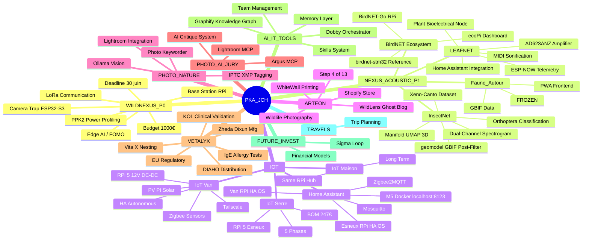
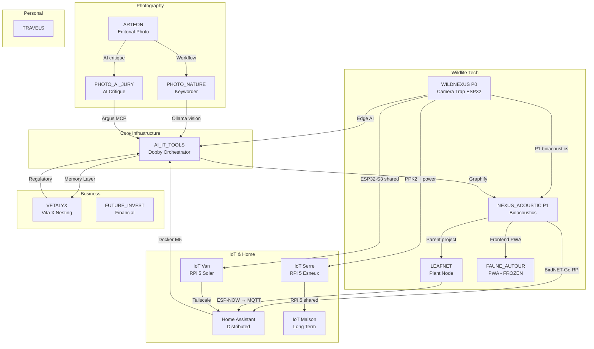
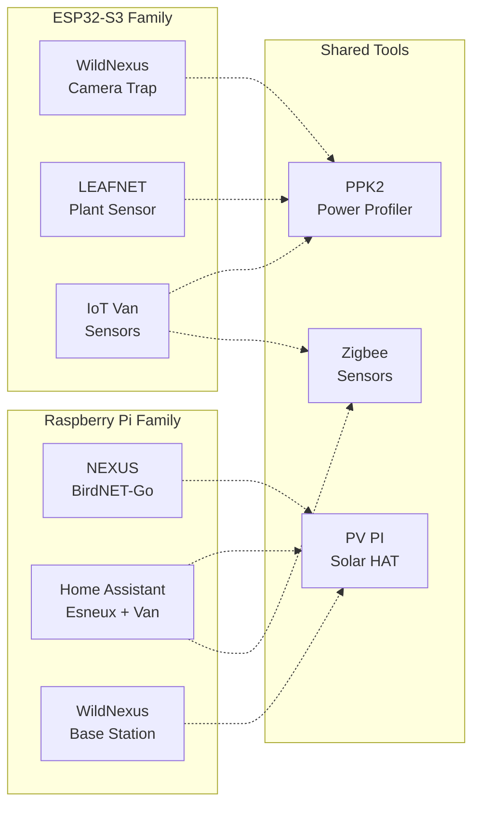

# PKA_JCH — Project Mindmap

> Generated: 2026-06-23 — Dobby 🦉
> Format: Mermaid (compatible Obsidian, GitHub, mermaid.live)

## Connection Map

## Hardware Convergence

---

*Visualiser sur https://mermaid.live ou dans Obsidian avec le plugin Mermaid.*
